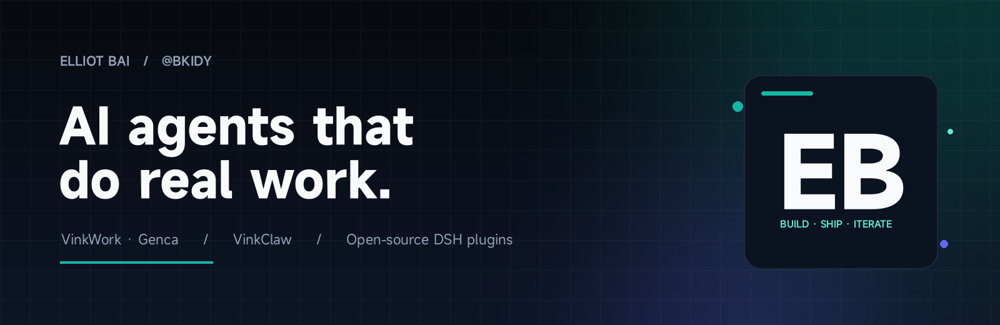
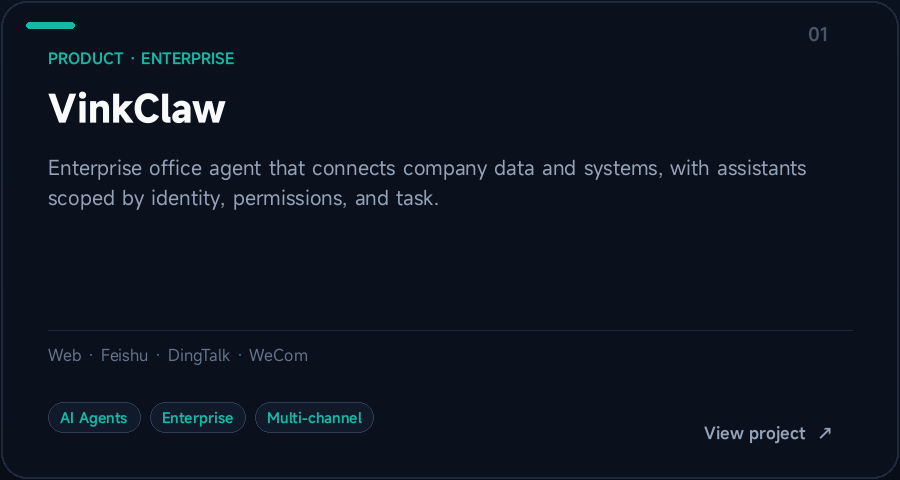
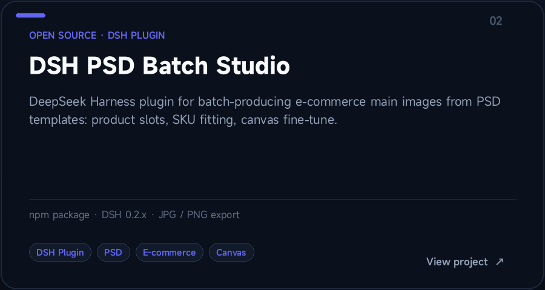
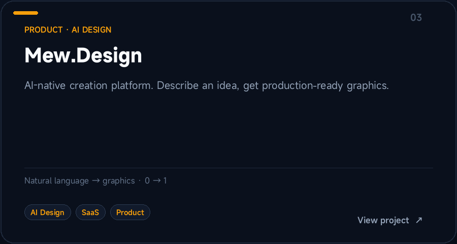
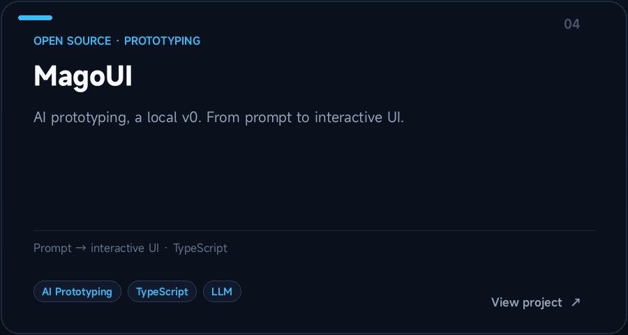
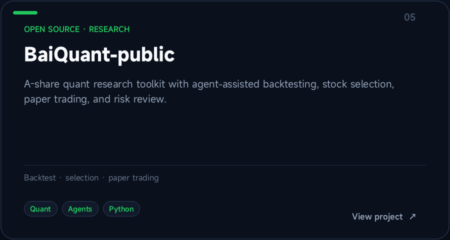
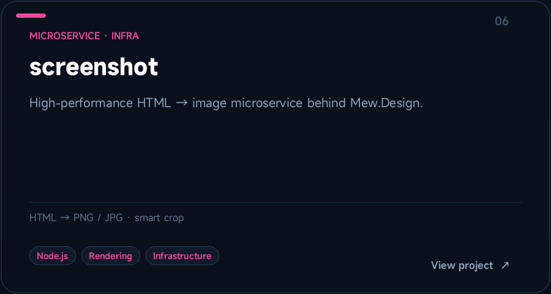

  

  

  
  
  
  

I build AI agents that do real work.

Currently at **VinkWork (Genca)**, building **[VinkClaw](https://www.vinkclaw.com)** — an enterprise office agent that connects company data and systems and gives every employee an assistant scoped by identity, permissions, and task. Web, Feishu, DingTalk, WeCom.

I care about the unglamorous loop around the model: context, memory, permissions, observability, evaluation, reliability.

中文：在 VinkWork（Genca）做企业级 AI Agent，核心产品 VinkClaw；也在做电商设计自动化的开源工具。

## What I'm building

<table>
  <tr>
    <td width="50%"></td>
    <td width="50%"></td>
  </tr>
</table>

## Selected work

<table>
  <tr>
    <td width="50%"></td>
    <td width="50%"></td>
  </tr>
  <tr>
    <td width="50%"></td>
    <td width="50%"></td>
  </tr>
</table>

**Earlier experiments:** [RedInk](https://github.com/bkidy/RedInk) · [Dida_spider](https://github.com/bkidy/Dida_spider) · [rea](https://github.com/bkidy/rea)

## Toolbox

  

  LLM agents · DSH / Cordis · Canvas / PSD · e-commerce automation

## Elsewhere

[VinkClaw](https://www.vinkclaw.com) · [X @bkidallen](https://twitter.com/bkidallen) · [Mew.Design](https://mew.design)

  VinkWork · Genca · Shanghai

