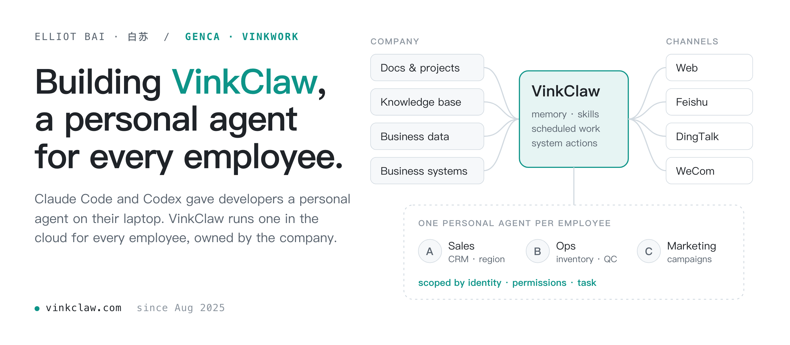
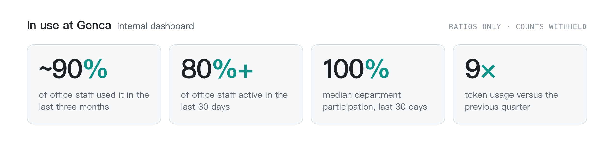
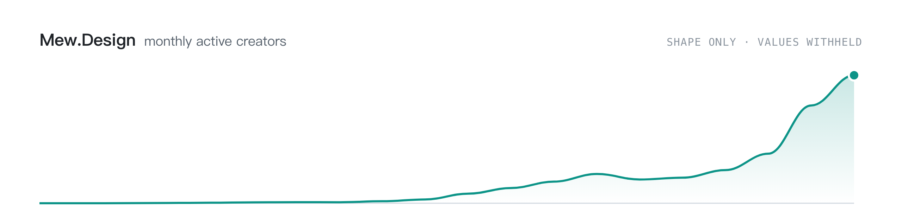

<a href="https://www.vinkclaw.com">
  <picture>
    <source media="(prefers-color-scheme: dark)" srcset="assets/hero-dark.png">
    
  </picture>
</a>

I'm Elliot (白苏). I design and build AI products end to end, from the product idea to the runtime it runs on. Since August 2025 I've been at **Genca**, on the VinkWork team, building **[VinkClaw](https://www.vinkclaw.com)**. Before that I built **[Mew.Design](https://mew.design)** from zero.

现在在缙嘉集团（Genca）VinkWork 团队做 VinkClaw：面向企业、跑在云端的 personal agent，每位员工一个。之前从零做了 Mew.Design。

## Now: VinkClaw, the enterprise personal agent

This was the year of the personal agent. Claude Code and Codex showed what happens when an agent gets its own workspace, tools and memory: it stops answering and starts finishing work. But they live on one developer's laptop, against one person's files, under one person's credentials.

VinkClaw takes that shape to a whole company and moves it to the cloud. We made the first commit in January 2026, before OpenClaw made personal agents mainstream, and today it is part of daily work across Genca.

| | A personal agent on a laptop | VinkClaw |
| --- | --- | --- |
| **For** | One developer | Every employee, from sales to the warehouse |
| **Runs** | In a local terminal | In the cloud, in a sandboxed workspace per person |
| **Reached from** | The terminal or IDE | Web, Feishu, DingTalk and WeCom, including group chats |
| **Works in** | Your repository | A personal space, plus shared project spaces with history |
| **Knows how** | Your own skills | The company skill library, then project skills, then personal ones |
| **Allowed to** | Whatever your machine can do | What the employee's identity, membership and task allow, acting with their own authorization |
| **Runs when** | You are at the keyboard | Also on a schedule, and whenever someone @-mentions it |
| **Belongs to** | The user | The company: knowledge, methods and agent versions stay when people move on |

<picture>
  <source media="(prefers-color-scheme: dark)" srcset="assets/stats-dark.png">
  
</picture>

What that looks like in a group chat:

| Someone asks | What VinkClaw does |
| --- | --- |
| *"Why did the sunscreen sell so well yesterday?"* | Drills into the sales, splits the lift by own live stream, creators and paid traffic, and finds the trigger: a hero SKU, the brand's own live room and a seasonal campaign landing on the same day. |
| *"Why is this batch showing as locked?"* | Queries the inventory and QC systems: QC hasn't released the batch, so the system locked it. Offers to push that to the owner. |
| *"Set up a sync tomorrow afternoon with these four."* | Finds a time, people and a room, creates the event and notifies everyone. |
| *(nobody asks)* | Runs on schedule: the 16:00 business brief, the evening doc check, Monday's weekly report, each sent to the right group. |

From the same team, open source: **[DSH PSD Batch Studio](https://github.com/vinkwork/dsh-psd-batch-studio)**, a DSH plugin that applies SKUs to PSD key-visual templates in bulk, lets you fine-tune on the canvas, and exports the whole batch.

## What building agents has taught me

1. **Scope comes before smarts.** An enterprise agent is defined by what it is allowed to see and do. Identity, permissions and the task at hand should decide the context, not the other way round.
2. **Go where the work already is.** Adoption happens in Feishu, DingTalk and WeCom group chats. Asking people to open a new app is a tax.
3. **Finish the loop, not the answer.** Real work ends with a confirmed result: the meeting booked, the owner nudged, the task closed. An agent that only answers leaves the hard half to people.
4. **Memory is a product decision.** What gets compressed, what stays word for word and what never leaves a thread are choices users feel. The user's history is never rewritten; only the model's view of it is.
5. **Methods are assets.** When a team proves a way of working, save it as a skill or a schedule so it runs again tomorrow and stays when people move on.
6. **Every call leaves evidence.** Route models by scene through one policy, record what ran and what it cost, and settle usage through a ledger: reserve first, then settle or release, with idempotent keys.

## Upstream contributions

I build on open agent frameworks and send fixes back when production finds their edges.

**[Mastra](https://github.com/mastra-ai/mastra)**, the TypeScript agent framework both VinkClaw and Mew.Design run on:

- [#19316](https://github.com/mastra-ai/mastra/pull/19316) Normalize legacy file parts before V4 providers, so data-URI attachments no longer serialize as `null`
- [#19305](https://github.com/mastra-ai/mastra/pull/19305) Advertise metrics and logs storage capabilities explicitly, so Studio stops guessing from class names
- [#18566](https://github.com/mastra-ai/mastra/pull/18566) Cache static sub-agent tool schemas across repeated tool conversion
- [#18375](https://github.com/mastra-ai/mastra/pull/18375) Show an empty state and stop polling when the logs storage can't list logs
- [#18096](https://github.com/mastra-ai/mastra/pull/18096) Persist versioned agent fields through `editor.agent.update()`

**[Dify](https://github.com/langgenius/dify)**, the LLM app platform:

- [#38112](https://github.com/langgenius/dify/pull/38112) Full-text and hybrid search for TiDB Vector

## Before: Mew.Design

An AI-native design tool: describe an idea and get production-ready graphics, or a full design you can keep editing in chat. I built it from the first commit, product and engineering.

<picture>
  <source media="(prefers-color-scheme: dark)" srcset="assets/mew-dark.png">
  
</picture>

## My open-source projects

| Project | What it is |
| --- | --- |
| [rea](https://github.com/bkidy/rea) | Reverse engineer anything with agents, from app behavior down to native binaries. |
| [MagoUI](https://github.com/bkidy/MagoUI) | AI prototyping that runs locally, an early take on a local v0. |
| [BaiQuant-public](https://github.com/bkidy/BaiQuant-public) | Agent-assisted A-share research: backtesting, stock selection, paper trading and risk review. |
| [screenshot](https://github.com/bkidy/screenshot) | The HTML-to-image service behind Mew.Design, with smart cropping. |

---

  <a href="https://www.vinkclaw.com">vinkclaw.com</a> ·
  <a href="https://mew.design">mew.design</a> ·
  <a href="https://twitter.com/bkidallen">X @bkidallen</a>

